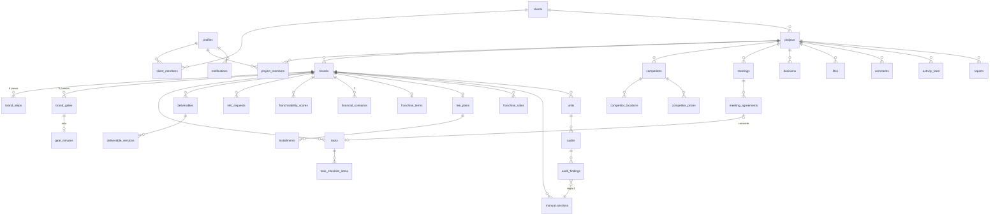

# Portal ESCALA · Modelo de datos y mapa de pantallas (propuesta para aprobación)

> Franquicias Exitosas · Método ESCALA® — "Estructura · Desarrolla · Expande"
> Estado: **borrador para aprobar**. No se ha escrito código todavía.

---

## 0. Decisiones de arquitectura

| Tema | Propuesta |
|---|---|
| Framework | Next.js App Router + TypeScript + Tailwind + shadcn/ui. Ver la nota sobre la versión en §5. |
| Backend | Supabase: Postgres + Auth (enlace mágico) + Storage + Realtime. |
| Seguridad | RLS en **todas** las tablas. Las reglas de negocio críticas (reglas ESCALA 2, 5, 6 y 7) se aplican con **triggers y funciones en Postgres**, no solo en la interfaz. |
| Multi-proyecto | Un consultor (o varios admins) → muchos clientes → muchos proyectos → muchas marcas por proyecto. |
| Plantilla | Tablas `tpl_*` (versionadas). Al crear un proyecto, la función `create_project_from_template()` copia pasos, puertas, tareas, entregables y solicitudes en cada marca. Después todo es editable sin tocar la plantilla. |
| Moneda | `currency` = `BOB` (por defecto) o `USD` en el proyecto y en cada monto. Formato `Bs 35.000,00`. |
| Fechas | `timestamptz` en BD; se muestran siempre en `America/La_Paz`. Planificación en `date`. |
| Correo | Resend (enlaces mágicos con SMTP propio + notificaciones). Recordatorios con Vercel Cron → ruta `/api/cron/*`. |
| PDF | `@react-pdf/renderer` en el servidor (actas, informe quincenal) con la marca. |
| Mapa | Leaflet + OpenStreetMap (sin costo, sin API key). |
| Gráficos | Recharts (anillos, radar, barras de escenarios). |
| Tiempo real | Supabase Realtime en `tasks`, `deliverables`, `brand_steps`, `brand_gates`, `activity_feed`, `comments` y `notifications`. |

---

## 1. Modelo de datos

### 1.1 Diagrama de relaciones (resumen)



### 1.2 Tipos (enums)

| Enum | Valores |
|---|---|
| `app_role` | `admin`, `especialista`, `cliente` |
| `specialty` | `financiero`, `alimentos`, `legal`, `marketing`, `operaciones`, `tecnologia` |
| `visibility` | `interno`, `cliente` |
| `step_code` | `E`, `S`, `C`, `A1`, `L`, `A2` (la letra visible es `A` en ambos casos) |
| `pillar` | `estructuracion`, `desarrollo`, `expansion` |
| `gate_code` | `FRANQUICIABLE`, `RENTABLE`, `REPLICABLE`, `VENDIBLE`, `AUTONOMA` |
| `step_status` | `pendiente`, `en_curso`, `en_revision`, `cerrado`, `bloqueado` |
| `gate_status` | `pendiente`, `acta_enviada`, `observada`, `superada` |
| `task_status` | `por_hacer`, `en_curso`, `en_revision`, `hecho` |
| `priority` | `baja`, `media`, `alta`, `urgente` |
| `review_status` | `borrador`, `enviado`, `observado`, `aprobado` |
| `request_status` | `pendiente`, `recibido`, `observado`, `validado` |
| `data_label` (regla 1) | `comprobado`, `estimacion`, `supuesto` |
| `entry_format` (regla 3) | `kiosco`, `isla`, `local_pequeno`, `dark_kitchen`, `modulo_movil`, `otro` |
| `scenario` | `conservador`, `moderado`, `optimista` |
| `payment_status` | `pendiente`, `facturada`, `pagada` |
| `currency` | `BOB`, `USD` |

### 1.3 Identidad, clientes y proyectos

| Tabla | Campos clave | Notas |
|---|---|---|
| `profiles` | `id` (= auth.users), `full_name`, `email`, `role app_role`, `specialty`, `avatar_url`, `notify_email bool` | Se crea con trigger al registrarse. Por defecto `cliente`; el admin lo cambia al invitar. |
| `clients` | `id`, `name` (empresa), `legal_name`, `nit`, `logo_url`, `city`, `country`, `created_by` | Logo propio del cliente (se muestra junto al de Franquicias Exitosas). |
| `client_members` | `client_id`, `profile_id`, `is_primary` | Usuarios del cliente (Félix Alarcón y su equipo). |
| `projects` | `id`, `client_id`, `name`, `start_date`, `currency`, `status` (`activo`/`pausado`/`cerrado`), `template_version`, `next_meeting_id` | "Franquiciamiento Kfresas y Vaca Lechera". |
| `project_members` | `project_id`, `profile_id`, `role app_role` | Define quién entra al proyecto. Los especialistas deben ser miembros **y** además solo ven sus tareas. |
| `brands` | `id`, `project_id`, `name`, `logo_url`, `color`, `week_offset int`, `entry_format` (regla 3), `trademark_status` (`sin_registro`/`en_tramite`/`registrada`), `trademark_validated_at`, `first_opening_date`, `sort` | Kfresas (offset 0) y Vaca Lechera (offset 4). |

### 1.4 Plantilla ESCALA (datos semilla, solo admin edita)

| Tabla | Campos clave | Contenido semilla |
|---|---|---|
| `tpl_steps` | `code step_code`, `letter`, `name`, `stage`, `pillar`, `sort`, `ref_weeks_min`, `ref_weeks_max`, `starts_at_first_opening bool`, `closing_gate gate_code` | Los 6 pasos de la tabla del método. |
| `tpl_gates` | `code`, `name`, `sort`, `step_code`, `criterion` | Las 5 puertas con su criterio ("payback del franquiciado validado", etc.). |
| `tpl_tasks` | `step_code`, `title`, `description`, `specialty`, `default_visibility`, `sort`, `rel_start_week`, `rel_weeks` | Las tareas estándar de cada paso (lista del método). |
| `tpl_deliverables` | `step_code`, `title`, `description`, `installment_trigger` | Informe de franquiciabilidad, modelo financiero, manual de operaciones (53 puntos), recetario, dossier, plan a 5 años, etc. |
| `tpl_info_requests` | `category`, `title`, `description`, `is_trademark bool`, `sort` | Registro de marca, documentos societarios, puntos de venta, ventas 12-24 meses, costos, recetas, proveedores, menú, redes, interesados, metas a 5 años. |
| `tpl_criteria` | `code`, `name`, `weight numeric`, `is_veto bool`, `guide` | Los 9 criterios (20/15/15/10/10/10/10/5/5). Veto: rentabilidad y protección legal. |
| `tpl_manual_sections` | `code`, `title`, `sort` | Índice de 53 puntos del manual de operaciones. |

### 1.5 Ejecución por marca

| Tabla | Campos clave | Notas |
|---|---|---|
| `brand_steps` | `brand_id`, `step_code`, `planned_start`, `planned_end`, `actual_start`, `actual_end`, `status step_status`, `progress` (calculado) | Barras del Gantt. L y A2 quedan sin fecha hasta `first_opening_date`. |
| `brand_gates` | `brand_id`, `gate_code`, `planned_date`, `status gate_status`, `decision` (`franquiciar`/`ajustar`/`no_franquiciar` para FRANQUICIABLE), `passed_at` | Rombos. |
| `gate_minutes` (actas) | `brand_gate_id`, `version`, `content jsonb`, `status review_status`, `approved_by_user`, `approved_by_name`, `approved_at`, `approved_ip`, `pdf_file_id`, `content_hash` | El cliente aprueba con nombre + fecha/hora (La Paz). Se genera PDF y se guarda el hash del contenido aprobado. |
| `tasks` | `project_id`, `brand_id`, `step_code`, `title`, `description`, `assignee_id`, `status`, `priority`, `visibility`, `planned_start`, `due_date`, `completed_at`, `sort`, `source_agreement_id`, `created_by` | Kanban, lista, calendario y Gantt. |
| `task_checklist_items` | `task_id`, `text`, `done`, `sort` | |
| `deliverables` | `brand_id`, `step_code`, `title`, `status review_status`, `visibility`, `current_version`, `installment_id` (regla 7), `due_date` | Biblioteca por letra. |
| `deliverable_versions` | `deliverable_id`, `version`, `file_id`, `notes`, `submitted_at`, `reviewed_by`, `review_comment`, `review_status` | Historial de borrador → enviado → observado/aprobado. |
| `info_requests` | `brand_id`, `category`, `title`, `status`, `due_date`, `is_trademark`, `last_reminder_at`, `reminder_every_days` | Checklist de información pendiente del cliente; archivos en `files`. |

### 1.6 Módulos analíticos (fase C)

| Tabla | Campos clave | Notas |
|---|---|---|
| `franchisability_scores` | `brand_id`, `criterion_code`, `score 1-5`, `evidence text`, `data_label`, `scored_by` | Vista `v_franchisability` → promedio ponderado, semáforo y veto. Evidencia como archivos. |
| `competitors` | `project_id`, `name`, `format`, `digital_presence jsonb`, `source`, `observed_at`, `confidence data_label`, `notes` | Chico Fresa, Merengón Colombiano, Choco Fresa, Antojos. |
| `competitor_locations` | `competitor_id`, `address`, `lat`, `lng`, `city` | Mapa. |
| `competitor_prices` | `competitor_id`, `size_name`, `price`, `currency`, `grams`, `service_time_sec`, `data_label` | Cifras vacías = **[POR CONFIRMAR]**. |
| `financial_scenarios` | `brand_id`, `scenario`, `format entry_format`, `notes` | 3 por marca. |
| `financial_values` | `scenario_id`, `metric` (`inversion`, `ventas_mensuales`, `punto_equilibrio_meses`, `ebitda_mensual`, `payback_meses`, …), `value`, `currency`, `data_label` | Una fila por cifra → cada cifra lleva su etiqueta (regla 1). Importación desde Excel. |
| `franchise_terms` | `brand_id`, `entry_fee`, `royalty_pct`, `marketing_fund_pct`, `data_label`, `payback_validated_at`, `payback_validated_by` | Regla 2 (ver §1.9). |
| `manual_sections` | `brand_id`, `code`, `title`, `status`, `file_id` | Copia de `tpl_manual_sections`. |
| `units` | `brand_id`, `name`, `franchisee_name`, `format`, `city`, `opened_at`, `status` | Unidades abiertas (pasos L y A2). |
| `audits` / `audit_findings` | `unit_id`, `date`, `score` / `audit_id`, `manual_section_id NOT NULL`, `severity`, `description`, `status`, `task_id` | Regla 4: cada hallazgo apunta a una sección del manual. |
| `unit_kpis` | `unit_id`, `period`, `metric`, `value`, `data_label` | Tablero de la red (A2). |

### 1.7 Bitácora, honorarios, informes y notificaciones

| Tabla | Campos clave | Notas |
|---|---|---|
| `meetings` | `project_id`, `title`, `scheduled_at`, `location_or_link`, `minutes rich text`, `visibility` | La próxima reunión aparece en el dashboard del cliente. |
| `meeting_agreements` | `meeting_id`, `text`, `owner_id`, `due_date`, `task_id` | Botón "Convertir en tarea" → crea `tasks` y guarda el vínculo. |
| `decisions` | `project_id`, `brand_id`, `decided_on`, `title`, `description`, `owner_id`, `file_id`, `visibility`, `status` (`pendiente`/`tomada`) | |
| `fee_plans` | `brand_id`, `base_amount`, `currency`, `vat_pct` (13 %), `success_fee_pct` (10 %) | **Solo admin.** |
| `installments` | `fee_plan_id`, `label`, `pct`, `amount`, `trigger` (`firma` o `gate_code`), `due_date`, `status payment_status`, `invoice_no`, `invoiced_at`, `paid_at` | 40 % firma / 30 % RENTABLE / 30 % REPLICABLE. |
| `franchise_sales` | `brand_id`, `franchisee_name`, `signed_at`, `base_amount`, `success_fee_amount` (calculado), `status payment_status` | El fee se calcula automáticamente. |
| `reports` | `project_id`, `period_start`, `period_end`, `snapshot jsonb`, `pdf_file_id`, `visibility`, `generated_by` | Informe quincenal. |
| `notifications` | `user_id`, `type`, `title`, `body`, `link`, `read_at`, `emailed_at` | Tipos: entregable por revisar, tarea vencida, comentario nuevo, puerta próxima, cuota por vencer. |

### 1.8 Tablas transversales

| Tabla | Campos clave | Notas |
|---|---|---|
| `files` | `project_id`, `brand_id`, `entity_type`, `entity_id`, `bucket`, `path`, `name`, `mime`, `size`, `visibility`, `uploaded_by` | Metadatos de todo archivo de Storage. |
| `comments` | `project_id`, `entity_type`, `entity_id`, `body`, `visibility`, `author_id` | Tareas, entregables, actas, solicitudes. El cliente solo crea comentarios con visibilidad `cliente`. |
| `activity_feed` | `project_id`, `brand_id`, `actor_id`, `kind`, `summary`, `entity_type`, `entity_id`, `visibility`, `created_at` | Se llena con triggers ("Tarea completada", "Entregable enviado"). Alimenta "Lo que hicimos por ti esta semana". |

### 1.9 Las 7 reglas ESCALA en la base de datos

| Regla | Cómo se aplica |
|---|---|
| 1. Etiqueta de cada cifra | Las columnas numéricas de negocio llevan `data_label`. `CHECK (value IS NULL OR data_label IS NOT NULL)`. Un `value` nulo se muestra como **[POR CONFIRMAR]**. |
| 2. El franquiciado gana primero | Trigger en `franchise_terms`: rechaza `entry_fee`/`royalty_pct` distintos de nulo si `payback_validated_at` es nulo. Solo se valida el payback si existe `payback_meses` del escenario moderado. |
| 3. Formato más simple | `brands.entry_format` obligatorio para salir de S; el Gantt y el modelo financiero lo destacan. |
| 4. El manual manda | `audit_findings.manual_section_id NOT NULL` (FK). |
| 5. Sin marca registrada no se vende | Trigger en `brand_steps` y `tasks`: el paso `A1` no pasa a `en_curso` (ni sus tareas a `en_curso`/`hecho`) si `brands.trademark_status <> 'registrada'` o la solicitud de registro de marca no está `validado`. En la interfaz se ve un candado. |
| 6. Ninguna etapa avanza sin acta | Trigger en `brand_steps`: `status = 'cerrado'` requiere un `gate_minutes` con `status = 'aprobado'` para la puerta de cierre de ese paso. La aprobación del acta marca la puerta como `superada` (y dispara el confeti). |
| 7. El método es de Franquicias Exitosas | Bucket `templates` solo para admin. La descarga de entregables pasa por la RPC `get_deliverable_download_url()`, que firma la URL solo si la cuota vinculada está `pagada` (si no, se ve "Disponible al pagar la cuota 2"). |

### 1.10 Row Level Security

Funciones auxiliares (`security definer`, `stable`):

- `is_admin()` → el perfil tiene rol `admin`.
- `project_role(project_id)` → rol del usuario en el proyecto (o nulo).
- `can_read(project_id, visibility)` → admin: siempre; cliente: miembro **y** `visibility = 'cliente'`; especialista: miembro (y además filtrado por asignación donde aplique).

| Grupo de tablas | Admin | Especialista | Cliente |
|---|---|---|---|
| Plantilla `tpl_*` | CRUD | lectura | lectura (pasos, puertas, criterios) |
| `clients`, `projects`, `brands`, `brand_steps`, `brand_gates` | CRUD | lectura de sus proyectos | lectura de sus proyectos |
| `tasks` (+ checklist) | CRUD | lectura/edición **solo asignadas** | lectura si `visibility = cliente` |
| `comments`, `files` | CRUD | en entidades que puede ver | lectura `cliente`; inserta solo con `visibility = cliente` |
| `deliverables`, `deliverable_versions` | CRUD | lectura/escritura en sus tareas | lectura `cliente`; cambia el estado a `observado`/`aprobado` vía RPC |
| `gate_minutes` | CRUD | lectura | lectura; aprueba vía RPC `approve_gate_minutes(id, full_name)` |
| `info_requests` | CRUD | lectura | lectura + carga de archivos + estado `recibido` |
| Matriz, competidores, finanzas del modelo | CRUD | lectura/escritura (financiero, legal…) | lectura si se marcan `cliente` (p. ej., resultado de la matriz) |
| `fee_plans`, `installments`, `franchise_sales` | CRUD | **sin acceso** | **sin acceso directo**; ve su estado de cuenta en la vista `v_account_statement` (RPC filtrada) |
| `decisions`, `meetings`, `reports`, `activity_feed` | CRUD | lectura | lectura `cliente` |
| `notifications` | — | solo las propias | solo las propias |

Storage: buckets privados `project-files` (ruta `project_id/brand_id/…`, políticas que llaman a `can_read` usando la fila de `files`), `templates` (solo admin), `reports`, y el bucket público `branding` (logos).

### 1.11 Datos semilla del ejemplo

- Admin: **Renzo Parada** (Franquicias Exitosas). Cliente: **Félix Alarcón**.
- Proyecto "Franquiciamiento Kfresas y Vaca Lechera" con 2 marcas:
  - Kfresas: E sem 1-4, S 5-10, C 11-20, A 21-26.
  - Vaca Lechera (desfase 4): E 5-8, S 9-14, C 15-24, A 25-30.
  - L y la segunda A: sin fecha hasta la primera apertura.
- Honorarios por marca: Bs 35.000 + IVA, cuotas 40/30/30 (firma, RENTABLE, REPLICABLE), fee de éxito 10 %.
- Competidores: Chico Fresa, Merengón Colombiano, Choco Fresa y Antojos, con todos los datos en **[POR CONFIRMAR]**.
- **Sin cifras inventadas** de ventas ni de mercado: los valores numéricos quedan nulos.

---

## 2. Mapa de pantallas

### 2.1 Acceso
| Ruta | Pantalla |
|---|---|
| `/login` | Correo → enlace mágico. Marca Franquicias Exitosas. |
| `/auth/callback` | Intercambio de sesión y redirección según el rol (admin/especialista → `/consultor`, cliente → `/portal`). |

### 2.2 Portal del cliente (`/portal`) — móvil primero
| Ruta | Contenido |
|---|---|
| `/portal` | Si tiene un solo proyecto, entra directo; si no, elige proyecto. |
| `/portal/[proyecto]` | **Dashboard héroe**: E·S·C·A·L·A gigante (hechas en rojo sólido, la actual con pulso, pendientes en gris), 5 rombos de puertas, anillos de avance total y por marca, 4 tarjetas (tareas de la semana, entregables por revisar, días a la próxima puerta, información pendiente), bloque **Acción requerida de tu parte**, feed "Lo que hicimos por ti esta semana", próxima reunión y último informe. Confeti al superar una puerta. |
| `/portal/[proyecto]/avance` | Gantt de solo lectura (planificado vs. real). |
| `/portal/[proyecto]/tareas` | Tareas visibles (lista y kanban de lectura) con comentarios. |
| `/portal/[proyecto]/entregables` | Biblioteca por letra; revisar, observar o aprobar; descarga si la cuota está pagada. |
| `/portal/[proyecto]/puertas/[puerta]` | Acta digital → "Apruebo" con nombre completo → PDF. |
| `/portal/[proyecto]/informacion` | Checklist de información solicitada con carga de archivos. |
| `/portal/[proyecto]/reuniones` | Próximas reuniones, minutas y decisiones visibles. |
| `/portal/[proyecto]/informes` | Informes quincenales en PDF. |
| `/portal/[proyecto]/estado-de-cuenta` | Cuotas y fees: monto, estado y vencimiento. |

Navegación del cliente: barra inferior en el celular (Inicio · Avance · Entregables · Información · Más) y barra lateral con las fichas E S C A L A en el escritorio.

### 2.3 Consola del consultor (`/consultor`)
| Ruta | Contenido |
|---|---|
| `/consultor` | Cartera: proyectos con su palabra ESCALA en miniatura, alertas (vencidas, actas pendientes, solicitudes atrasadas), cobros por vencer. |
| `/consultor/clientes` · `/[id]` | Clientes, logo, usuarios invitados. |
| `/consultor/proyectos/nuevo` | Asistente: cliente → marcas (desfase, formato de entrada) → fecha de inicio → honorarios → **crear desde la plantilla ESCALA**. |
| `/consultor/p/[proyecto]` | Resumen + botón "Ver como cliente". |
| `…/gantt` | Gantt editable (arrastrar barras), carril por marca, rombos, línea de hoy, retrasos. |
| `…/tareas` | Kanban / lista / calendario, filtros (marca, letra, responsable, vencidas), panel lateral de la tarea. |
| `…/entregables` | Biblioteca, versiones, envío al cliente, vínculo con cuota. |
| `…/puertas` | Estado de las 5 puertas por marca, redacción y envío de actas. |
| `…/informacion` | Solicitudes al cliente, validación, recordatorios. |
| `…/matriz` | Matriz de franquiciabilidad (E): puntajes, evidencia, semáforo, radar comparativo. |
| `…/competidores` | Fichas, mapa y tabla comparativa (E). |
| `…/finanzas-modelo` | Escenarios, importación Excel, gráficos, validación de payback → canon/regalía (S). |
| `…/manual` | 53 secciones del manual, unidades, auditorías y hallazgos (C, L, A). |
| `…/bitacora` | Decisiones y reuniones; acuerdos → tareas con un clic. |
| `…/honorarios` | Plan, cuotas, franquicias vendidas y fee de éxito. **Solo admin.** |
| `…/informes` | Generar el informe quincenal (vista previa → PDF → publicar). |
| `…/equipo` | Miembros, especialistas e invitaciones. |
| `/consultor/plantilla` | Editor de la plantilla ESCALA (pasos, tareas, entregables, criterios, 53 secciones). |
| `/consultor/mis-tareas` | Vista del especialista: solo sus tareas (también le sirve al consultor). |
| `/notificaciones`, `/ajustes` | Centro de avisos, preferencias de correo, modo oscuro. |

### 2.4 Componentes de marca reutilizables
`<EscalaWord/>` (palabra héroe), `<EscalaTile letter/>` (ficha cuadrada roja), `<GateDiamond/>` (rombo), `<ProgressRing/>`, `<DataLabelBadge/>` (comprobado / estimación / supuesto / [POR CONFIRMAR]), `<VisibilityToggle/>` (interno / cliente), `<Money/>` (Bs/USD), `<Confetti/>`, `<LockedStep reason/>`.

---

## 3. Estructura de carpetas propuesta

```
src/
  app/
    (auth)/login, auth/callback
    portal/[projectId]/{avance,tareas,entregables,puertas/[gate],informacion,reuniones,informes,estado-de-cuenta}
    consultor/{clientes,proyectos/nuevo,plantilla,mis-tareas}
    consultor/p/[projectId]/{gantt,tareas,entregables,puertas,informacion,matriz,competidores,finanzas-modelo,manual,bitacora,honorarios,informes,equipo}
    api/{cron/reminders,cron/overdue,pdf/acta/[id],pdf/informe/[id],import/excel}
  components/{ui (shadcn), escala, gantt, tasks, charts, layout}
  lib/{supabase/{server,client,middleware},escala (reglas y cálculos),format (Bs, fechas La Paz),pdf,email}
  types/database.ts (generado por Supabase)
supabase/
  migrations/  0001_core.sql · 0002_escala_template.sql · 0003_execution.sql · 0004_analytics.sql · 0005_fees.sql · 0006_rls.sql · 0007_storage.sql
  seed.sql     plantilla ESCALA + ejemplo Kfresas / Vaca Lechera
docs/escala/   este documento + guía de despliegue
```

---

## 4. Plan por fases

- **Fase A**: auth con enlace mágico, roles, clientes/proyectos/marcas, plantilla + `create_project_from_template`, dashboard del cliente (héroe, anillos, tarjetas, feed, acción requerida), consola básica.
- **Fase B**: Gantt, tareas (3 vistas), entregables con versiones, actas de puerta + PDF + confeti, solicitudes de información, comentarios/archivos, Realtime.
- **Fase C**: matriz, competidores + mapa, modelo financiero + Excel, bitácora, honorarios + estado de cuenta, informe quincenal, notificaciones (app + correo + cron).

Cada fase termina con: `npm run build` y lint sin errores, pruebas de RLS con usuarios de cada rol (cliente no ve `interno` ni honorarios; especialista solo ve sus tareas) y revisión en el celular.

---

## 5. Preguntas abiertas para aprobar

1. **Repositorio**: este repo es el *Cotizador Comercial* (en producción). Propuesta: construir el portal en un **repositorio y proyecto de Supabase nuevos** para no mezclar tablas ni roles.
2. **Versión de Next.js**: se pidió Next 14, pero ya no recibe soporte; este repo usa Next 16. Propuesta: usar **Next 16** (App Router, igual de compatible con shadcn/ui y Supabase SSR).
3. **Base del fee de éxito (10 %)**: ¿sobre el derecho de entrada (canon) cobrado al franquiciado o sobre otro monto?
4. **IVA**: ¿13 % sobre Bs 35.000 (Bs 39.550 por marca) y la factura la emite Franquicias Exitosas?
5. **Correo**: ¿Resend con un dominio propio (p. ej. `portal.franquiciasexitosas.com`)?
